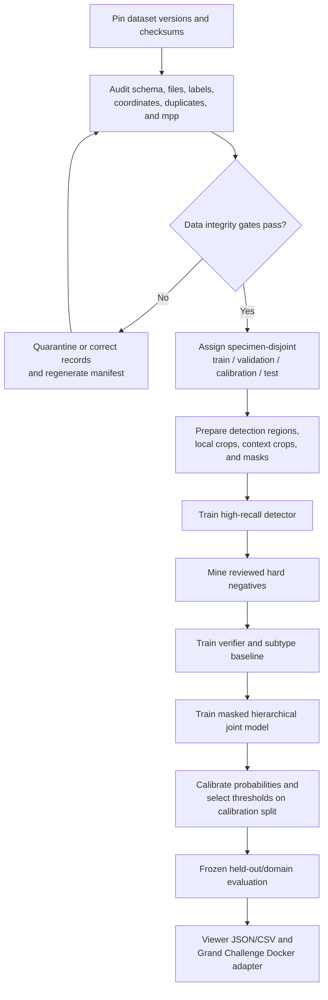

# MitoGuard / MIDOG 2025

MitoGuard is a research pipeline for joint mitotic-figure detection, rejection
of mitotic mimics, and normal-versus-atypical mitosis classification under
scanner, laboratory, tissue, stain, and tumor-domain shift.

The repository currently provides reproducible dataset acquisition, a deep data
audit, specimen-disjoint splits, a resource-bounded candidate-level pilot, and a
Google Colab setup notebook. The proposed YOLO-family detector and LoRA-adapted
DINOv3 joint model remain planned research components; they are not represented
as trained or validated results.

## Research tasks

- **Track 1 — detection:** locate mitotic figures in clean, random, and adverse
  tissue regions.
- **Candidate verification:** distinguish genuine mitoses from apoptotic cells,
  inflammatory cells, necrotic debris, staining artifacts, and other mimics.
- **Track 2 — subtyping:** classify an accepted mitosis as normal (NMF) or
  atypical (AMF).
- **Domain generalization:** retain performance across unseen acquisition and
  biological domains.

## Proposed architecture

```mermaid
flowchart LR
    A["H&E WSI / TIFF region"] --> B["Read image metadata<br/>mpp, scanner, provenance"]
    B --> C["Physical-scale normalization<br/>and tiled inference"]
    C --> D["High-recall proposal detector<br/>YOLO-family"]
    D --> E["Candidate center + proposal score"]
    E --> F["Local morphology crop"]
    E --> G["Wider tissue-context crop"]
    F --> H["Pretrained DINOv3 encoder<br/>LoRA adaptation"]
    G --> I["Shared or lightweight<br/>context encoder"]
    H --> J["Local embedding zL"]
    I --> K["Context embedding zC"]
    J --> L["Residual context gate<br/>zV = zL + g * Wc(zC)"]
    K --> L
    L --> M["Verification head<br/>pM = P(true mitosis)"]
    J --> N["Morphology-safe subtype head<br/>pA = P(atypical | mitosis)"]
    M --> O["Calibration and hierarchical fusion"]
    N --> O
    O --> P["Background / Normal / Atypical<br/>or pathologist-review state"]
```



The hierarchical probabilities are:

```text
P(background) = 1 - pM
P(normal)     = pM * (1 - pA)
P(atypical)   = pM * pA
```

Context is used primarily for verification. The default subtype path uses the
local morphology representation to reduce contextual shortcuts. Context-assisted
subtyping is an ablation, not a presumed improvement.

## End-to-end workflow



## Inputs and outputs

| Stage | Input | Output |
|---|---|---|
| Detector | WSI/TIFF tile, physical resolution, valid-region mask | Candidate center or box and proposal confidence |
| Crop extraction | Candidate coordinate and image metadata | Aligned local and context RGB crops |
| Verification | Local/context crops | `pM`, probability of a genuine mitosis |
| Subtyping | Local morphology crop for a known/accepted mitosis | `pA`, conditional probability of atypia |
| Hierarchical fusion | Calibrated `pM` and `pA` | Background, normal, and atypical probabilities |
| Selective review | Probabilities and calibration policy | Accepted prediction or explicit review referral |
| Export | Coordinates, probabilities, provenance | Viewer-compatible JSON/CSV and challenge output |

An inference record should preserve at least:

```json
{
  "image_id": "330.tiff",
  "x": 4210.5,
  "y": 1682.0,
  "proposal_probability": 0.98,
  "verification_probability": 0.96,
  "normal_probability": 0.18,
  "atypical_probability": 0.78,
  "predicted_class": "atypical",
  "review_required": false
}
```

## Sample preparation and preprocessing

### 1. Provenance and release pinning

1. Record dataset name, release/version, source URL, license, and checksum.
2. Use the corrected MIDOG 2025 Track 2 CSV pinned in `download.py`.
3. Retain source specimen, slide, scanner, laboratory, tumor, and species IDs.
4. Never treat two releases of the same source object as independent samples.

### 2. Image and coordinate harmonization

- Read microns-per-pixel from each TIFF when available; do not hard-code
  0.25 microns/pixel. Relevant images may use approximately 0.12–0.25
  microns/pixel.
- Normalize physical field of view before resizing to a network tensor.
- Preserve the native-to-model coordinate transform for export.
- MIDOG++ `bbox` values are `[x0, y0, x1, y1]`, not COCO
  `[x, y, width, height]`.
- Confirm XY orientation, offsets, image dimensions, and bounds visually on
  random objects from every domain.
- Pad boundary crops deterministically and record that padding was applied.

### 3. Detection samples

- Construct tiles only from regions with a known annotation-validity policy.
- Positive samples are verified mitotic objects.
- Negative samples may include annotated mimics and reviewed detector false
  positives.
- An unmatched prediction in incompletely reviewed tissue is **not** an
  automatic negative.
- Retain difficult tissue strata such as necrosis, inflammation, staining
  artifacts, and random non-hotspot tissue for subgroup evaluation.

### 4. Verification and subtype crops

| Crop | Initial prototype | Purpose |
|---|---:|---|
| Local morphology | Approximately 128 px when compatible with source physical scale | Chromosomes, spindle form, multipolarity, lagging material |
| Tissue context | Approximately 256 or 384 px after physical-scale alignment | Mimic rejection and adverse-region context |

Final crop dimensions must be selected in physical units on validation data.
The two crops must share a candidate center and a documented scale transform.
Subtype supervision applies only where an expert subtype label exists; missing
subtype labels are masked rather than guessed.

### 5. Splitting and leakage prevention

- Split by specimen, patient, or parent slide—not by crop.
- Every derived crop inherits its parent split.
- Use a shared manifest for Track 1 and Track 2 because Track 2 objects are
  derived from Track 1 coordinates.
- Keep validation, calibration, and final test specimens separate.
- Use leave-one-domain-out experiments only when domain identity and sample
  counts support the comparison.
- Detect overlap by source identity, exact hashes, and perceptual similarity.

### 6. Training-only augmentation

- Rotations and flips that preserve the target morphology.
- Bounded optical-density or stain-matrix perturbation.
- Low-severity acquisition noise and compression perturbation.
- Optional context dropout for the verification branch.
- Avoid aggressive deformation, arbitrary cut-and-paste, or synthetic atypical
  cells in the primary analysis because they may change the target morphology.
- Apply no stochastic augmentation to validation, calibration, or test data.

### 7. Tensor normalization

- Convert crops to RGB explicitly.
- Resize only after physical-scale harmonization.
- Use the selected pretrained encoder's documented channel normalization.
- Estimate any dataset-specific normalization from training samples only.
- Record crop size, target mpp, interpolation, normalization, and augmentation
  parameters in the run configuration.

## Model and training plan

| Component | Initial baseline | Research model |
|---|---|---|
| Proposals | Compact YOLO-family detector | Tuned high-recall detector with domain evaluation |
| Representation | Frozen or compact pretrained encoder | DINOv3 with LoRA; pathology encoder comparator |
| Verification | Binary weighted cross-entropy | Residual local/context gate with context dropout |
| Subtyping | Weighted cross-entropy | Local morphology head; focal/SupCon ablations |
| Joint learning | Conventional detector-to-classifier cascade | Masked partial-label hierarchical objective |
| Calibration | Fixed validation threshold | Temperature scaling and selective review |

Training should proceed in gates: independent detector and subtype baselines,
conventional cascade, masked hierarchy, context fusion, robustness additions,
and finally calibration. Optional complexity is added only after its preceding
baseline is reproducible.

## Colab execution

Open [`notebooks/MitoGuard_Colab_Training.ipynb`](notebooks/MitoGuard_Colab_Training.ipynb)
in Google Colab and select a GPU runtime. Its safe default path:

1. checks GPU, memory, and disk;
2. mounts Google Drive;
3. clones or updates this repository;
4. installs the package and runs tests;
5. downloads corrected Track 2 data and Track 1 metadata;
6. runs the data audit;
7. runs the candidate-level pilot when Track 1 TIFFs are available;
8. writes a commit-specific readiness manifest and report archive.

The approximately 65 GB Track 1 image download is deliberately disabled by
default. Set `DOWNLOAD_TRACK1_IMAGES = True` only after checking Drive quota and
accepting the dataset terms. The notebook reports a clear stop condition until
the proposed GPU training modules are implemented; it does not fabricate a deep
training result.

## Local quick start

Python 3.10+ is supported.

```bash
python -m venv .venv
# Windows
.venv\Scripts\activate
# Linux/macOS
source .venv/bin/activate
python -m pip install -e ".[dev]"
```

Download Track 2 and Track 1 metadata:

```bash
midog-download --track all-metadata
```

Download the full Track 1 image set (approximately 65 GB, opt-in):

```bash
midog-download --track track1-images --i-understand-size --workers 8
```

Run the audit and bounded CPU pilot:

```bash
midog-audit --workers 8
midog-pilot
```

The pilot uses HOG/color features and two balanced SGD classifiers. Annotation
coordinates serve as proposals, so the pilot validates the data-to-prediction
path—not whole-slide detection or final research performance.

## Repository structure

```text
.
├── configs/                         Dataset and pilot configuration
├── data/                            Ignored raw/interim/processed data
├── models/                          Ignored weights and checkpoints
├── notebooks/
│   └── MitoGuard_Colab_Training.ipynb
├── reports/generated/               Audit and pilot artifacts
├── src/midog2025/
│   ├── audit.py                     Integrity, leakage, label, and image audit
│   ├── data.py                      Dataset loading and grouped splits
│   ├── download.py                  Resumable checksum-aware data wiring
│   ├── paths.py                     Portable path configuration
│   └── pilot.py                     Resource-bounded hierarchical pilot
├── tests/
├── MitoGuard_Final_Research_Methodology.md
└── pyproject.toml
```

## Audit coverage

The audit checks schema and file membership, invalid/missing labels, duplicate
IDs and coordinates, exact and perceptual duplicates, image decoding, TIFF
resolution, expert agreement, class/domain imbalance, bounding-box geometry,
cross-track overlap, and WSI-level leakage risk. Outputs include an HTML report,
JSON summary, issue table, image inventories, plots, and a deterministic
WSI-grouped split manifest.

## Evaluation

Track 1 should report challenge-radius F1 and average precision overall and by
domain/tissue stratum. Track 2 should report balanced accuracy, AUROC,
sensitivity, specificity, F1, and calibration. The joint system should report
spatially matched background/normal/atypical errors, atypical precision/recall,
unmatched detections/truth, and selective risk versus review coverage.

Thresholds and calibration parameters are chosen on specimen-disjoint
validation/calibration data and frozen before final evaluation.

## Submission contracts

Grand Challenge inference is packaged in Docker. Start from the organizer
templates rather than recreating the I/O contract:

- [Track 1 reference Docker](https://github.com/DeepMicroscopy/MIDOG25_T1_reference_docker)
- [Track 2 reference Docker](https://github.com/DeepMicroscopy/MIDOG25_T2_reference_docker)
- [Submission guide](https://midog2025.deepmicroscopy.org/submitting/)

Track 1 writes `/output/mitotic-figures.json`; coordinates are physical when
spacing metadata is available. Track 2 consumes stacked ROI cropouts.

## Data and citations

Raw data and model weights are not committed. Review upstream licenses and cite
every dataset used:

- [MIDOG 2025 datasets](https://midog2025.deepmicroscopy.org/datasets/)
- [MIDOG++](https://github.com/DeepMicroscopy/MIDOGpp)
- [MIDOG 2025 challenge](https://midog2025.grand-challenge.org/)
- [Official getting-started guide](https://github.com/DeepMicroscopy/MIDOG_2025_Guide)
- [Challenge specification](https://zenodo.org/records/15077361)
- [Challenge paper](https://arxiv.org/abs/2606.07368)

The code is MIT licensed; dataset licenses remain with their upstream sources.
